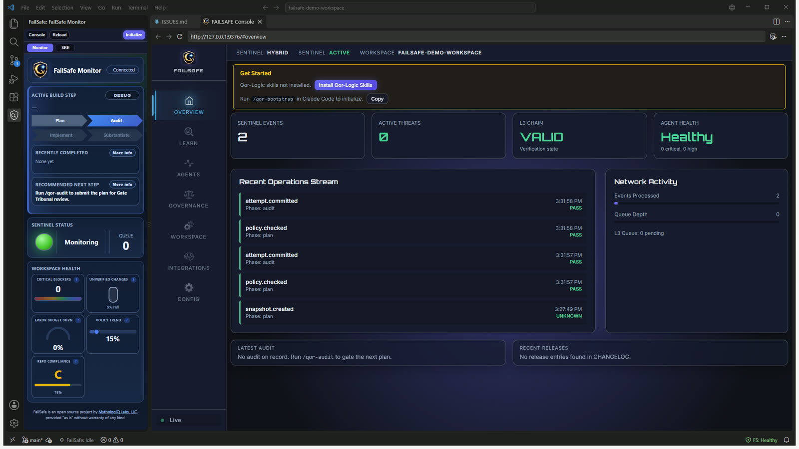
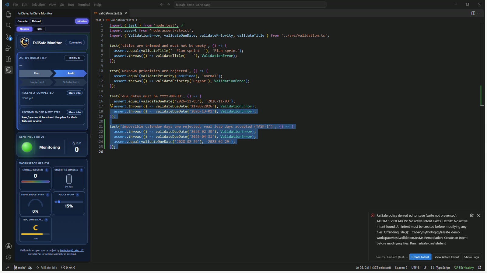
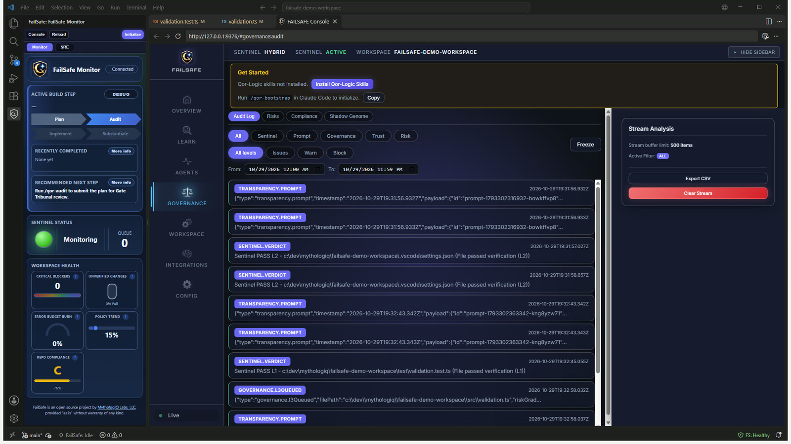

# FailSafe

**Know what your AI coding agents are doing. Keep development decisions accountable.**

Local-first governance, workspace monitoring, and evidence for AI-assisted software development.

Developing FailSafe? Start with the [Architecture Index](docs/ARCHITECTURE_INDEX.md).

## Understand and govern AI-assisted development

AI coding agents can write code faster than teams can always review their decisions. FailSafe adds a local, inspectable governance layer to your editor workflow. It helps you see what changed, understand relevant risks, establish intent, and retain evidence for review.

FailSafe is a VS Code extension with a Monitor and a broader Console. It **does not** promise that every agent action is intercepted, that arbitrary processes are sandboxed, or that VS Code editor saves can be prevented. Controls depend on the action path and integration involved.

## What you can do with FailSafe

- **See workspace activity.** Review Sentinel findings, change signals, and operational risk in the Monitor and Console.
- **Work from explicit intent.** Associate work with an active intent and review policy decisions and higher-risk approvals.
- **Review supported agent workflows.** Inspect governed changes and apply them deliberately, rather than assuming every agent write is automatically safe.
- **Trace decisions and evidence.** Use checkpoints, audit history, and governance records to understand what happened and what remains unverified.
- **Bring external work into governance.** Opt-in Jira and Linear issue previews can become reviewed local intent drafts. Other integrations offer risk ingestion, agent observations, or notifications, depending on their capabilities.

## See it in action

These screenshots were captured from the **6.0.11 release candidate** in VS Code on Windows, working in a fictional demo repository ([how they were made](docs/marketing/MEDIA_MANIFEST.md)).

*The FailSafe Monitor and Console inside VS Code, watching a repository.*

*FailSafe flags a change made without an active intent. It reports editor saves; it does not prevent them.*

*Every verdict and review request is recorded in the Console's audit log.*

For older screens, including the previous Console and Monitor captures, see the [UI and technical reference](docs/archive/README_LEGACY_REFERENCE.md).

## Get started

1. **Install** FailSafe from the [VS Code Marketplace](https://marketplace.visualstudio.com/items?itemName=MythologIQ.mythologiq-failsafe) or [Open VSX](https://open-vsx.org/extension/MythologIQ/mythologiq-failsafe).
2. **Open** a project workspace in VS Code or Cursor.
3. **Open the Console** with `FailSafe: Open Console (Browser Popout)` or `Ctrl+Alt+F`.
4. **Inspect your workspace** with `FailSafe: Audit Current File`.
5. **Configure governance** with `FailSafe: Set Up Agent Governance` if you want supported agents to receive FailSafe guidance.

The extension's [full getting-started and command reference](FailSafe/extension/README.md) explains optional setup and platform constraints.

## Local-first by design

FailSafe's core monitoring and governance run locally. External integrations are opt-in and may send data to their configured providers when you invoke them. Review each integration's privacy and permission contract before enabling it. Local-first is not a claim that every optional integration is offline.

## Current release and what's coming

**Current Release**: v6.0.10, the latest published release ([release notes](https://github.com/MythologIQ-Labs-LLC/FailSafe/releases/tag/v6.0.10)). See the [release history](CHANGELOG.md) for fixes, security corrections, and packaged platform support.

Newer work on `main` may not yet be available in the marketplace release. Check [GitHub Releases](https://github.com/MythologIQ-Labs-LLC/FailSafe/releases) before assuming a repository feature is installed.

## For developers and agentic contributors

**Start here: [Architecture Index](docs/ARCHITECTURE_INDEX.md).** It routes you to canonical design documents, existing decisions, related implementation contracts, and verification. Search that index before adding a new architecture document or changing a design boundary.

- [Architecture Index](docs/ARCHITECTURE_INDEX.md): the design-intent spine and document registration path.
- [Governance Index](docs/GOVERNANCE_INDEX.md): Qor-logic governance artifact authority, tiers, and history.
- [Contributing](CONTRIBUTING.md): how to make and review contributions.
- [Integration portfolio](docs/architecture/INTEGRATION_PORTFOLIO.md): value contracts and current integration assessments.
- [Historical technical README](docs/archive/README_LEGACY_REFERENCE.md): detailed material previously carried in this landing page; not canonical authority.

FailSafe is open source under the [Apache 2.0 license](LICENSE).
